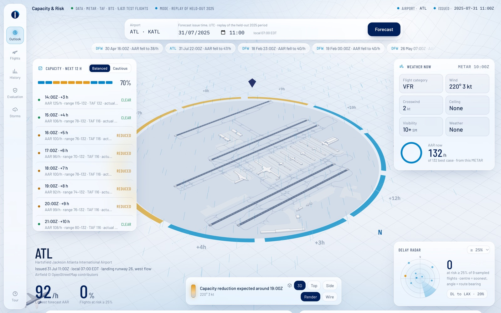
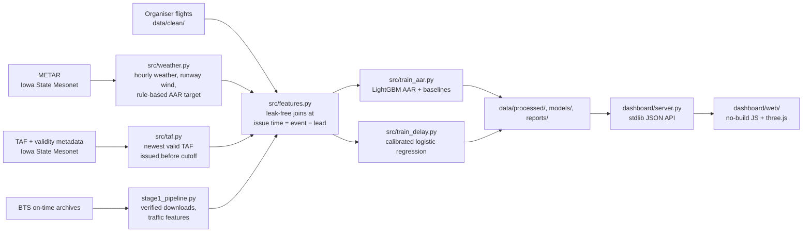

# Capacity & Risk: airport capacity and severe-delay forecasting (ATL, DFW)

Forecasts, **3 to 12 hours ahead**, for Atlanta (KATL) and Dallas/Fort Worth (KDFW):

1. the hourly **Arrival Acceptance Rate (AAR)**, with an 80% range, scored by RMSE;
2. the probability that a flight suffers a **severe delay (> 45 min)**, calibrated and scored by PR-AUC and Brier.

Both are shown to an air-traffic duty manager in a web dashboard with history, flight-level drivers and
plain-language recommendations. Built for **Autonomous SG 2026, AI & Aerospace track, Airbus Challenge #5**
("Predictive Airport Capacity and Weather Delay Risk"; brief in [`Problem Statements.md`](Problem%20Statements.md)).



> The dashboard is a **replay of the held-out January–July 2025 test period**, not a live forecast. Models never saw 2025 data.

## Results (test set, Jan–Jul 2025)

**AAR forecast**: RMSE in arrivals per hour, both airports, 10,121 hours per lead time.

| Lead | LightGBM (ours) | TAF-implied rule | Persistence | Climatology |
|---:|---:|---:|---:|---:|
| 3 h | **12.2** | 15.4 | 17.9 | 18.4 |
| 6 h | **12.7** | 15.3 | 20.7 | 18.4 |
| 9 h | **12.8** | 15.3 | 22.3 | 18.4 |
| 12 h | **12.9** | 15.5 | 23.3 | 18.4 |

The 80% interval covers 87 to 89% of hours. Trained on one airport and tested on the other, 3 h RMSE moves from
14.1 to 14.9 at ATL (still ahead of every ATL baseline) and from 10.1 to 13.6 at DFW, where it falls behind the
TAF-implied rule (11.9) ([`reports/aar_unseen_airport.csv`](reports/aar_unseen_airport.csv)).

**Severe-delay classifier**: 5,697 test flights, 13.2% severe. Each row adds one feature group.

| Features | PR-AUC, 3 h | PR-AUC, 12 h |
|---|---:|---:|
| Base rate (no model) | 0.132 | 0.132 |
| Schedule only | 0.217 | 0.217 |
| + recent hub performance | 0.245 | 0.224 |
| + METAR (observed weather) | 0.303 | 0.237 |
| + TAF (forecast weather) | 0.318 | 0.269 |
| + BTS airport traffic (**final**) | **0.319** | **0.269** |

The final model is a regularised, calibrated logistic regression (Brier 0.104 at 3 h vs 0.116 for the base rate).
LightGBM was tried and lost out-of-fold ([`reports/delay_model_selection.csv`](reports/delay_model_selection.csv)).
Every metric, baseline, bootstrap interval and failure case is in [`reports/`](reports/).

## How it works



* **AAR target.** No public dataset publishes the hourly called AAR, so the target is derived from FAA-published
  called rates by flight category (VFR/MVFR/IFR/LIFR, in [`src/config.py`](src/config.py)) with documented hazard
  reductions for crosswind, tailwind, gusts, thunderstorms and winter precipitation ([`src/aar.py`](src/aar.py)). The target is
  a ratio to each airport's best-case rate, so the model carries no airport ID.
* **Leakage control.** Every feature is computed as of the forecast issue time: the latest METAR already *published*,
  the newest TAF issued at least `lead` hours earlier *and* valid for the target hour, and only flights already
  completed. Enforced by assertions and [`tests/`](tests/).
* **Chronological evaluation.** Train 2023-01 to 2024-06, validate 2024-07 to 12, test 2025-01 to 07. Never shuffled;
  the first test day and flights spanning two splits are purged.
* **Dashboard.** [`dashboard/server.py`](dashboard/server.py) is a `http.server` handler with no framework, and
  [`api/index.py`](api/index.py) re-exports it as the Vercel function, so local and deployed behaviour are identical.
  The frontend is plain ES modules; three.js loads from a CDN import map, so there is no build step.

### API

All endpoints are `GET`, return JSON and take `airport=KATL|KDFW`.

| Endpoint | Extra params | Returns |
|---|---|---|
| `/api/meta` | | Airports, replay window, the worst-capacity days to jump to |
| `/api/outlook` | `t0` (UTC issue time), `sens=balanced\|cautious`, `thr` (risk threshold) | 3–12 h AAR forecast with range, current weather, at-risk flights, recommendations |
| `/api/history` | `t0` | Last 30 days of AAR and predicted vs observed delay rate, plus a weekday × hour low-capacity heatmap |
| `/api/eval` | `lead` | Test-set metrics against baselines |
| `/api/storm` | `lead` | Storm-hour results from the full-BTS pipeline |
| `/api/explain` | `t0`, `sens`, `thr` | Optional plain-English summary from Claude (needs `ANTHROPIC_API_KEY`) |

## Quick start

Requires Python 3.13.

```bash
pip install -r requirements.txt
python dashboard/server.py
```

Then open http://localhost:8502. This runs from the committed replay snapshot (`data/processed/`, `models/`,
`reports/`), with no downloads or training.

To rebuild everything from source:

```bash
pip install -r requirements-dev.txt
python run_pipeline.py                 # download -> clean -> features -> train -> evaluate (cached after first run)
python run_pipeline.py --skip-download # offline replay from the verified cache
python run_pipeline.py --sensitivity   # optional: re-test the AAR assumptions (about 8 min)
python -m pytest -q tests test_stage1_pipeline.py   # leakage, physics and data-integrity checks
streamlit run dashboard/app.py         # the earlier Streamlit version of the dashboard
```

**Inputs.** `data/clean/flights_clean.csv` (organiser flight data, already cleaned) plus public data the pipeline
downloads by itself for 2023-01 to 2025-07:

* METAR observations from the Iowa State Mesonet (`data/weather/raw/`).
* TAF forecasts with issuance and validity metadata (Iowa State Mesonet), BTS reporting-carrier on-time archives
  and OpenFlights airport time zones, fetched by `stage1_pipeline.py` into `data/external/`. The first run downloads
  about 1 GB. Every file is validated and gets a `.source.json` receipt with its URL and SHA-256; later runs reuse the
  cache, and `--skip-download` refuses to run if anything is missing or changed. Raw archives are not committed;
  only the small `airports.dat` lookup is included for deployment.

## Repository layout

| Path | Purpose |
|---|---|
| `src/config.py` | Airports (ICAO, time zone, runway heading, FAA AAR table), time split, leads. Add an airport here and the pipeline picks it up |
| `src/download.py` | Cached METAR downloads (retry) |
| `stage1_pipeline.py` | Verified TAF / TAF-metadata / BTS / airport downloads, TAF validity normalisation, BTS airport-traffic features (tests: `test_stage1_pipeline.py`) |
| `src/weather.py` | METAR cleaning, runway head/cross/tailwind from the runway heading, hourly table, weather-adjusted AAR |
| `src/aar.py` | The AAR rule (FAA called rates by flight category + hazard reductions) |
| `src/taf.py` | Parses TAFs; for each target hour reads the newest TAF issued *before* the forecast time, if it is valid for that hour |
| `src/features.py` | AAR table and delay table (leak-free joins, recent hub performance, BTS airport traffic) |
| `src/train_aar.py` | LightGBM AAR forecaster + baselines, RMSE, event detection, unseen-airport test |
| `src/train_delay.py` | Severe-delay classifier: picks the model family out-of-fold, ablations, calibration, bootstrap, failure cases |
| `src/sensitivity.py` | Does the conclusion survive different AAR assumptions? Does the AAR rule agree with real BTS arrivals? |
| `src/advisory.py` | Rule-based recommendations for the controller |
| `dashboard/server.py`, `dashboard/web/` | Decision-support dashboard: a stdlib JSON API over the pipeline outputs and a no-build page with a three.js airfield. Visual design adapted from [Torque Stripe](https://github.com/aljabrialam/torque-stripe) (MIT) |
| `dashboard/build_airfields.py` | Builds the airfield geometry in `dashboard/web/airfields.js` from OpenStreetMap |
| `dashboard/app.py` | The earlier Streamlit version of the dashboard |
| `api/index.py`, `vercel.json`, `.vercelignore` | Vercel deployment (see below) |
| `jho/aerocast_data/` | Full-BTS pipeline (`run_all.py`): BTS, METAR, TAF and NOAA Storm Events, LightGBM, its own reports. Source of `reports/jho_*.csv` |
| `jho/*.ipynb`, `jho/data/clean/` | Corrected versions of the exploratory notebooks and their cleaned output. Not read by the main pipeline |
| `tests/` | Invariant tests: no look-ahead, wind geometry, AAR rule, chronological splits, TAF validity, stale weather, purging, API contract |
| `reports/` | All metrics as CSV |
| `presentation/` | 14-slide deck (built by `build_deck.py` from `reports/`), judges' brief PDF, and `LEARNING_BRIEF.md` (what was built and why, with Q&A prep) |

`weather_download.ipynb` and `data_cleaning.ipynb` are the earlier exploratory notebooks; the scripts above supersede them.

## Design decisions

* **Leakage:** every weather feature comes from the latest METAR hour already *published* at `issue time = event - lead`; TAFs must have been issued at least `lead` hours before the target hour; "recent hub performance" and BTS traffic only count flights already completed at the issue time.
* **TAF validity:** the newest TAF issued before the cutoff must also be valid for the target hour, using the Mesonet issuance/validity metadata. An expired, not-yet-valid or malformed newest TAF gives missing values; there is no fallback to an older forecast.
* **Stale or missing weather stays unknown:** if the last real METAR is more than 2 h old at the issue time, the row is kept but its weather is blank (`wx_stale = 1`). "Not reported" defaults (no ceiling = 12,000 ft, no gust/precipitation = 0) apply only to hours that had a report. Local times that daylight saving makes ambiguous or nonexistent are dropped, not shifted.
* **Airport traffic:** BTS reporting-carrier archives give scheduled movements in the event hour and operations completed in the 3 h before the issue time. BTS is a demand proxy, not all traffic and not AAR; final schedules are retrospective.
* **Runway directionality:** wind is converted to head/tail/crosswind with the assigned runway headings (ATL 80, DFW 180), and the AAR rule penalises crosswind and tailwind, not raw wind speed.
* **Not tied to one airport:** the AAR target is a ratio to the airport's best-case rate, the model has no airport-ID feature, and an unseen-airport test is reported. Unknown runway heading falls back to the prevailing wind direction.
* **Normalised delays:** delay is a rate (share of flights > 45 min), never raw minutes; results are shown per airport and per direction.
* **Time-based evaluation:** train 2023-01..2024-06, validation 2024-07..12, test 2025-01..07, never shuffled. The first day of 2025 is purged, as is any flight whose departure and arrival fall in different splits. The delay model uses expanding-window cross-validation over 2024 for hyper-parameters; Platt calibration is kept only if a fit on 2024 Q1-Q3 lowers the Brier score on 2024 Q4.
* **AAR ground truth:** the target is derived from FAA-published called rates plus hazard reductions. This is the biggest assumption, so it is stress-tested (`reports/aar_sensitivity.csv`) and checked against real airport-wide BTS arrivals in busy hours (`reports/aar_vs_traffic.csv`). The direction holds: in the busiest quarter of hours, the share of scheduled arrivals that actually land falls steadily as the rule's AAR falls (ATL 94% → 87%, DFW 81% → 71% from the top to the bottom AAR band). The rank correlation is weak (0.12 ATL, 0.17 DFW), and BTS demand (about 70 arrivals/h) sits well below the rule's VFR rates, so the rule's absolute level is not confirmed, only its direction.

## Extra evidence from the full-BTS pipeline

A second pipeline in `jho/aerocast_data` (run with `python run_all.py --start 2023-01 --end 2025-07`) rebuilds the
flights from the full BTS archive (3,255,141 ATL/DFW flights, not the 0.5% organiser sample) and adds three things
the main pipeline does not have. Its outputs are copied into `reports/` as `jho_*.csv` so the dashboard and deck can
use them directly.

| File | What it shows |
|---|---|
| `jho_storm_hours_arrivals.csv` | Arrivals per hour in **storm hours only** (a NOAA Storm Event within 50 km overlaps the target hour). RMSE rises from about 7 to 8 in normal hours to about 17 to 20, and the 90% interval covers only about half. Still better than climatology and schedule at both airports and every lead. |
| `jho_storm_hours_severe_delay.csv` | Severe-delay PR-AUC in storm hours, model vs climatology, with a 95% bootstrap interval over storm hours. Clearly better for DFW arrivals at all leads, ATL departures at 3 and 6 h and DFW departures at 3 h; no clear difference elsewhere (ATL arrivals rest on only 32 storm hours). Never clearly worse. |
| `jho_actual_arrivals_metrics.csv` | Forecast of **actual** BTS arrivals per hour (3/6/9/12 h), against persistence, climatology and schedule, for all hours, busy hours and storm hours. A check on the rule-based AAR target using observed data. |
| `jho_actual_arrivals_unseen_airport.csv` | Same target, trained on one airport and tested on the other, normalised by each airport's own 95th percentile. |
| `jho_fullbts_severe_metrics.csv`, `jho_fullbts_severe_calibration.csv` | Severe-delay classifier (LightGBM) trained and tested on full BTS: about 45,000 test flights per airport, direction and lead, against 5,697 in total for the organiser-sample model. |

* **NOAA Storm Events are labels only.** They are compiled after the event, so they mark which test hours were storm hours and are never a model input.
* **The RMSE values are not comparable** with `aar_metrics.csv`: that file scores the rule-based AAR, these score real arrivals. They answer different questions and support each other.
* A thunderstorm-timing feature (TAF thunder within 2 h of the target hour) was tried and rejected on validation; the before-and-after reports are in `jho/aerocast_data/data/reports_before_tafwin/`.

## Deploying on Vercel

Vercel serves `dashboard/web/` from its CDN and routes `/api/*` to one Python function ([`api/index.py`](api/index.py)).
Only the frontend output is public; replay data and models are function inputs. `.vercelignore` allowlists the
deployment inputs and excludes raw downloads, local environments, notebooks, Streamlit and training-only files.
No build step runs the pipeline.

| Setting | Value |
|---|---|
| Root Directory | Repository root (`.`), not `dashboard/web` |
| Framework Preset | Other |
| Build Command | Empty (provided by `vercel.json`) |
| Output Directory | `dashboard/web` |
| Python | 3.13 (provided by `.python-version`) |
| Build environment variable (Preview and Production) | `VERCEL_PYTHON_DISABLE_RUNTIME_INSTALL=1` |
| Optional runtime environment variable | `ANTHROPIC_API_KEY` enables Claude's plain-English outlook summary |

The build variable keeps dependencies in the function bundle and avoids the CLI's dependency-externalization failure
for newer Linux wheel tags when building on macOS. Without `ANTHROPIC_API_KEY` the summary button stays hidden and
every other view still works. Local `.env` files are excluded from deployment.

**Refreshing the replay snapshot.** Run `python run_pipeline.py` locally (or `--skip-download` with a complete verified
cache), then `python -m pytest -q tests test_stage1_pipeline.py`. Commit the four allowlisted files in
`data/processed/`, `data/external/airports.dat`, the ten `models/delay_lead*.joblib` files and the updated `reports/`
together. Keep dependency pins aligned with the environment that wrote the joblib models; other generated files stay ignored.

**Validating a deployment.** After linking the project, run `npx vercel pull --environment=preview` then
`npx vercel build` (with the build variable present in the pulled environment). Check the Linux function bundle against
Vercel's [500 MB Python bundle limit](https://vercel.com/docs/functions/runtimes/python). The API uses about 1 GB at
peak when loading flight explanations; allow room for cold starts and concurrent requests.
